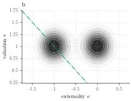
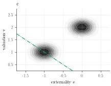
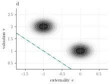
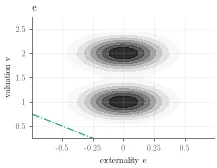
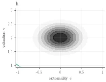
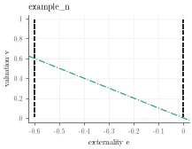
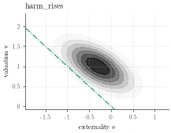
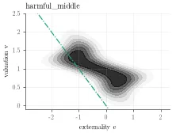

# Audited auctions: computation, optimization and experiments

Code for the WEB27 paper on auctions with participant audits (`WEB27/arxiv_WEB/` of the paper repository). The model has n bidders, k identical goods, and bidder types (e, v), where e is the externality and v the valuation.

For a type distribution and a participation threshold function τ(e) common to all bidders, the package computes exactly:

- the expected outcomes of four mechanisms: VCG without audits, VCG-PA, IVCG-PA (ironed VCG auction with participant audits), and the first best;
- the penalties r(e) that induce τ.

It also simulates per-auction outcomes, computes bootstrap intervals for empirical data, and searches for the τ that maximizes exact expected welfare. The search runs on a gridded (piecewise-uniform) type distribution; by default, everything after the search is evaluated on its continuous version ([§6](#continuous-evaluation)).

Further documentation:

- methods and modules: [audited_auctions/README.md](audited_auctions/README.md);
- methodology and output formats: the supplement `WEB27/drafting/code_supplement/` of the paper repository.

**Contents**

1. [Quick start](#1-quick-start)
2. [Command line: `run.py`](#2-command-line-runpy)
3. [Configuration files](#3-configuration-files)
4. [Outputs of a run](#4-outputs-of-a-run)
5. [Running on the BU SCC](#5-running-on-the-bu-scc)
6. [Distributions and data](#6-distributions-and-data)
7. [Python interface](#7-python-interface)
8. [Code layout and tests](#8-code-layout-and-tests)

## 1. Quick start

**Install** (Python ≥ 3.12):

```bash
uv sync                                   # with uv, from uv.lock
# or
python3 -m venv .venv
.venv/bin/pip install numpy scipy pandas matplotlib pygad pytest
```

**Run the smoke test** (6 combinations, about 15 s):

```bash
.venv/bin/python run.py configs/smoke_test.toml
```

The command prints the plan and a time estimate, asks to proceed, computes, draws the figures, and writes the run folder `runs/<date>_<time>_optimize_smoke-test/`. Open its `README.md` for the results.

**A minimal configuration** (`configs/my_run.toml`). It optimizes τ for n ∈ {4, 8, 16}, one good, on the synthetic family `harm_rises`, with two forms of τ, by best-response ascent:

```toml
kind = "optimize"
name = "harm-n"

[[distributions]]
source = "harm_rises"

[markets]
num_bidders = [4, 8, 16]
num_goods = [1]

[design]
objectives = ["vcg_pa"]

[[optimizers]]
method = "best_response"
threshold_forms = ["knots6", "nodes"]
```

```bash
.venv/bin/python run.py configs/my_run.toml --dry-run      # plan and time estimate only
.venv/bin/python run.py configs/my_run.toml --workers 8    # run with 8 processes
```

## 2. Command line: `run.py`

```
python run.py CONFIG.toml [--dry-run] [--yes] [--workers N] [--no-report]
python run.py --report RUN_FOLDER [--paper [NAMES]] [--workers N]
python run.py --options
```

| Option | Meaning |
|---|---|
| `CONFIG.toml` | configuration of the run ([§3](#3-configuration-files)); starts a new run folder |
| `--dry-run` | print the plan (combinations, skipped combinations) and the time estimate, then stop |
| `--yes` | do not ask before running (batch jobs) |
| `--workers N` | number of worker processes; overrides `output.workers`; default: number of cores − 2 |
| `--no-report` | compute only, no figures; overrides `output.report` |
| `--report RUN_FOLDER` | redraw every figure and README of an existing run from its saved data; no recomputation |
| `--paper [NAMES]` | with `--report`: export figures for a paper ([§4.6](#46-figures-for-a-paper)); `NAMES` is a comma-separated subset, default all |
| `--options` | list the distributions, forms, objectives, optimizer methods, threshold sources and every default |

**Examples:**

```bash
python run.py configs/standard_test.toml --dry-run
python run.py configs/standard_test.toml --yes --workers 12
python run.py --report runs/2026-10-20_1111_optimize_standard-test
python run.py --report runs/2026-10-20_1111_optimize_standard-test --paper outcomes,ironing
```

## 3. Configuration files

A run is described by one TOML file. Every list is a set of values. The run computes every combination of:

- the distributions and the ζ values of each;
- the lists in `[markets]` and `[design]`;
- the `[[optimizers]]` tables and the threshold forms of each (optimize runs), or the `[[thresholds]]` tables (evaluate runs).

Unknown keys are an error. Example files in [configs/](configs/):

| File | Purpose |
|---|---|
| [smoke_test.toml](configs/smoke_test.toml) | smoke test for code changes: 6 combinations (three optimizers, two distributions) through every stage, about 15 s; results not meaningful |
| [standard_test.toml](configs/standard_test.toml) | standard test: every feature on small grids, 120 combinations, about 3 min with 12 workers |
| [evaluate_example.toml](configs/evaluate_example.toml) | evaluate run: the zero-welfare threshold τ⁰, the ex ante cutoff τ*, and the optima of an earlier run |
| [optimize_example.toml](configs/optimize_example.toml) | research-size optimize run on the tweet data (several ζ, per-node τ) |

### 3.1 Top level

| Key | Values | Meaning |
|---|---|---|
| `kind` | `"optimize"`, `"evaluate"` | optimize: search for τ in each combination, then evaluate it; evaluate: evaluate given τ |
| `name` | text | part of the run folder name `<date>_<time>_<kind>_<name>` |
| `description` | text | shown in the run's README |

### 3.2 `[[distributions]]` (one table per distribution; at least one)

| Key | Default | Meaning |
|---|---|---|
| `source` | required | a synthetic family (`a`–`f`, `h`, `example_n`, `independent`, `harm_rises`, `harmful_middle`, `heavy_tail`), the data set `tweets`, or a path to a CSV file with columns `e_score`, `v_score` |
| `label` | source name | folder name of the distribution |
| `externality_scales` | `[1.0]` | externality scales ζ (e = ζ · e_score); one sub-folder `z<ζ>` each |
| `num_externality_nodes` | 151 (synthetic), 241 (empirical) | externality grid of the piecewise-uniform distribution |
| `num_valuation_cells` | 150 (synthetic), 400 (empirical) | valuation cells per externality node |
| `options` | `{}` | synthetic only: family parameters, e.g. `options = {correlation = -0.4}` for `harm_rises` ([audited_auctions/README.md](audited_auctions/README.md#synthetic-families)) |
| `valuation_scale` | 1.0 | empirical: valuation of one action (v = valuation_scale · v_score) |
| `truncation_quantile` | 0.995 | empirical: training rows with v above this quantile of all rows are dropped; the quantile is the valuation bound v̄ |
| `evaluation_truncation_quantile` | `truncation_quantile` | empirical: the same for the test rows (1.0 keeps every row) |
| `train_fraction` | 0.5 | empirical: share of rows in the training half |
| `smoothing` | `"kernel"` | empirical: training half kernel-smoothed (`"kernel"`) or used as atoms (`"none"`) |
| `bandwidth_scale` | 1.0 | empirical: multiplier of the kernel bandwidth |
| `evaluation` | `"atomic"` | empirical: test half as atoms (`"atomic"`) or smoothed like the training half (`"smoothed"`) |

### 3.3 `[markets]`

| Key | Default | Meaning |
|---|---|---|
| `num_bidders` | `[8]` | numbers of bidders n |
| `num_goods` | `[1]` | numbers of identical goods k |

### 3.4 `[design]` (optimize runs)

| Key | Default | Meaning |
|---|---|---|
| `objectives` | `["vcg_pa"]` | auction whose exact expected welfare τ maximizes: `vcg_pa`, `ivcg_pa` |

The forms of τ are set per optimizer (`threshold_forms` in `[[optimizers]]`, §3.5). A `threshold_forms` key in `[design]` is an error.

### 3.5 `[[optimizers]]` (optimize runs; default: one best-response optimizer)

Each table is one optimizer with its own forms of τ; the run computes every objective × optimizer × form of that optimizer.

**Every method:**

| Key | Default | Meaning |
|---|---|---|
| `method` | required | `genetic` (genetic stage + Nelder–Mead), `best_response` (best-response ascent + gradient polish), `genetic+best_response` (ascent also started from a genetic result), `relaxation` (ascent from the symmetric relaxation only; below) |
| `threshold_forms` | `["knots6"]`; `["nodes"]` for `relaxation` | forms of τ this optimizer searches (table below); a form the method cannot search is an error |
| `label` | `ga`, `br`, `ga-br`, `relax` | optimizer label in folder names |
| `time_limit_minutes` | 60 | search time per combination (all stages and starts); past it, each stage stops after its current iteration, later starts are skipped, the best τ so far is kept, and check `search_stop` fails; 0 = no limit |

| Form | τ(e) | Methods |
|---|---|---|
| `poly<d>` | polynomial of degree d | genetic |
| `knots<K>` | continuous piecewise linear with K knots, plus an exclusion cutoff | all |
| `bins<K>` | constant on K bins | all |
| `cutoff` | common welfare cutoff w: τ(e) = max(0, w − e), excluded if w − e > v̄ | genetic |
| `nodes` | free value at every externality node | best response, genetic+best response, relaxation |

Example: genetic search on a polynomial and a piecewise-linear τ, best-response ascent per node:

```toml
[[optimizers]]
method = "genetic"
threshold_forms = ["poly2", "knots6"]

[[optimizers]]
method = "best_response"
threshold_forms = ["nodes"]
```

**Genetic search** (`genetic`, and the genetic stage of `genetic+best_response`):

| Key | Default | Meaning |
|---|---|---|
| `num_generations` | 500 | maximum generations |
| `population_size` | 50 | population size |
| `num_parents_mating` | 15 | parents per generation |
| `mutation_probability` | 0.25 | mutation probability per gene |
| `range_multiplier` | 3.0 | width of the search ranges of polynomial coefficients |
| `stall_generations` | 60 | stop once the best welfare has risen by at most `stall_tolerance` over this many generations |
| `stall_tolerance` | 1e-4 | the stall rule's gain, in units of the first-best gain FB − W_VCG on the training distribution |
| `num_restarts` | 4 | independent restarts (seeds `search`, `search + 1`, …), run in parallel |
| `local_refinement` | `"nelder_mead"` | `"nelder_mead"` or `"none"` |
| `num_local_starts` | 5 | Nelder–Mead starts |
| `local_max_evaluations` | 2000 | evaluations per Nelder–Mead start |

**Best-response ascent** (`best_response`, `genetic+best_response`):

| Key | Default | Meaning |
|---|---|---|
| `starts` | `["zero", "zero_welfare", "short_genetic", "relaxation"]` | `zero`: τ ≡ 0; `zero_welfare`: the zero-welfare threshold τ⁰(e) = max(0, −e); `short_genetic`: a short genetic search in the same form; `relaxation`: the thresholds of the best symmetric participation rule for VCG-PA (`symmetric_relaxation.py`; skipped for atomic distributions) |
| `num_random_starts` | 3 | random starts in addition (τ piecewise linear through 6 externalities, values uniform on [0, 95% quantile of v]); all starts run in parallel |
| `max_iterations` | 100 | iterations per start |
| `relative_tolerance` | 1e-10 | stop when relative welfare gains fall below this |
| `polish_rounds` | 3 | gradient polishes |
| `short_genetic_generations` | 40 | generations of the `short_genetic` start |
| `genetic_form` | same form, or `knots6` for `nodes` | `genetic+best_response` only: form of the genetic stage |
| `warm_start_across_zeta` | false | also start from the optimum at the previous ζ, rescaled: τ(e) = τ_prev(e ζ_prev / ζ); the ζ values of a distribution then run in sequence |

**Symmetric relaxation** (`relaxation`). A linear program (`symmetric_relaxation.py`, about 5 s per distribution, n, k) finds the best symmetric participation rule for VCG-PA: each type participates with some probability, the same for all bidders. Its value bounds the VCG-PA welfare of every common τ from above (a midpoint estimate, error of order (interval width)²). τ is read off it (each node's threshold is the first valuation at which at least half of the node participates), projected on the form, and improved by best-response ascent from that single start, with the best-response keys above (`starts` and `num_random_starts` are ignored). `results.json` records the linear program under `search.relaxation`: `value`, `threshold_rule` (whether the best symmetric rule is a threshold rule; then the τ read off it is a best common τ for VCG-PA, up to the discretization, paper v3), `largest_drop`, `seconds`. The same τ is also one of the default `starts` of `best_response`, where the best start is kept; the separate method shows what the relaxation gives alone. With the objective `ivcg_pa` it is a start only (the relaxation is for VCG-PA). Needs k < n and a piecewise-uniform training distribution; other combinations are skipped and listed in the plan.

### 3.6 `[[thresholds]]` (evaluate runs; at least one)

Each table has a `label` (folder name `tau-<label>`) and exactly one source:

| Key | Example | τ(e) |
|---|---|---|
| `polynomial` | `[0.0, -1.0]` | Σ_m β_m e^m (coefficients from degree 0) |
| `constant` | `0.3` | 0.3 |
| `cutoff` | `0.0` or `"ex_ante"` | max(0, w − e) for welfare cutoff w; `0.0` gives the zero-welfare threshold τ⁰; `"ex_ante"` gives the ex ante cutoff w* with Pr[v + e > w*] = min{k/n, Pr[v + e > 0]} (paper Thm 8.9), computed on the training distribution for each n, k |
| `tabulated` | `{externalities = [-1, 0], values = [1, 0]}` | piecewise linear through the points, constant outside |
| `tau_file` | `"runs/<run>/<path>/tau.json"` | a τ saved by an earlier run |
| `from_run` | `"runs/<run>"` | every τ of an earlier run with the same distribution label, ζ, n and k (without `label`, the original design label is used) |

A τ value at or above v̄ excludes the externality (τ = v̄⁺ in the paper).

### 3.7 `[evaluation]`

| Key | Default | Meaning |
|---|---|---|
| `num_simulated_auctions` | 2000 | simulated auctions for the per-auction figures (the same auctions for every design of a market) |
| `num_bootstrap` | 200 | empirical: bootstrap resamples of the test rows |
| `confidence_level` | 0.95 | level of the bootstrap percentile intervals |
| `bootstrap_all_outcomes` | true | bootstrap every metric (revenue, penalties, welfare parts), not only welfare |
| `continuous` | true | evaluate on continuous versions of the gridded distributions ([§6](#continuous-evaluation)); the search stays on the grid. `false`: evaluate on the grid (runs made before this option) |

### 3.8 `[checks]`

| Key | Default | Meaning |
|---|---|---|
| `grid_refinement` | false | synthetic: recompute on a finer grid with τ fixed (continuous versions of both grids when `continuous`) |
| `refinement_factor` | 2 | refinement of both grids |
| `grid_relative_tolerance` | 0.01 | pass if every gain over VCG changes by less than this share |
| `bandwidth_sensitivity` | `[]` | empirical, optimize runs: redesign τ with these bandwidth multipliers, e.g. `[0.5, 2.0]` |
| `first_order_tolerance` | 1e-4 | `nodes` form: pass if max \|M(e, τ(e))\| / v̄ at interior thresholds is below this |
| `monte_carlo_z` | 4.0 | pass if every simulated mean is within this many standard errors of the exact value |
| `symmetric_relaxation` | true | piecewise-uniform training data: solve the best symmetric participation rule for VCG-PA (about 5 s per distribution, n, k; cached; shared with the `relaxation` method) and report the share of its gain that τ attains on the training grid |

### 3.9 `[seeds]`

| Key | Default | Used by |
|---|---|---|
| `split` | 0 | train/test split of empirical rows |
| `search` | 0 | genetic search and `short_genetic` starts |
| `simulation` | 1234 | simulated auctions |
| `bootstrap` | 0 | bootstrap resamples |

### 3.10 `[output]`

| Key | Default | Meaning |
|---|---|---|
| `base` | `"runs"` | folder of the run folders (relative to the code folder) |
| `workers` | 0 | parallel processes; 0 = number of cores − 2; `--workers` overrides. One process per combination; workers beyond the number of combinations go to each combination's parallel stages (search starts and restarts, Nelder–Mead starts, bootstrap) |
| `search_history_curves` | 400 | tried thresholds kept for `search/tried-taus.pdf` |
| `report` | true | draw figures after computing; `--no-report` overrides |

## 4. Outputs of a run

### 4.1 Run folder

Each run writes `runs/<YYYY-MM-DD_HHMM>_<kind>_<name>/` (not tracked by git):

```
runs/2026-10-19_1400_optimize_standard-test/
  README.md                index: inputs, check verdicts, results table, links to every figure
  config.toml              the configuration as given
  run.toml                 resolved configuration, git commit + dirty flag, versions, host (local / SCC + job id),
                           seeds, data SHA-256, start/end times, runtime per stage
  code.patch               uncommitted changes of tracked code (only when the tree was dirty)
  log.txt                  progress messages
  summary.csv              one row per combination
  checks.csv               one row per check and combination
  gap-decomposition.csv    welfare-gap decomposition per market and class of τ
  compare/share-of-first-best-gain.pdf
  <distribution>/
    compare/welfare-vs-zeta_<fixed inputs>.pdf          (only with several ζ)
    z<ζ>/
      types.npz            type-distribution background of the figures
      compare/tau-by-<input>_<fixed inputs>.pdf
      n<n>-k<k>/
        <objective>_<form>_<optimizer>/                 (evaluate runs: tau-<label>/)
          tau.json  tau.csv  first-order.csv  results.json  data.npz  README.md
          1_types-tau-penalties.pdf … 6_marginal-contribution.pdf
          search/tried-taus.pdf  search/convergence.pdf  search/iterations.pdf
          thumbs/*.webp  search/thumbs/*.webp
runs/index.csv             one line per run: folder, kind, name, start, seconds, combinations,
                           failures, failed checks, commit, dirty flag, host
```

A comparison figure goes in the `compare/` folder of the deepest level above every input it varies.

### 4.2 Tables and data files

Mechanisms: VCG, VCG-PA, IVCG-PA, first best. Metrics: welfare W, valuation welfare Σvx, externality welfare Σex, revenue (payments only), penalties paid, bidder utility, number of participants, number allocated.

| File | Contents |
|---|---|
| `summary.csv` | per combination: inputs; exact expected value of each metric for each mechanism; welfare gain over VCG, share of the first-best gain and revenue change per mechanism; bootstrap bounds; training welfare; search and total seconds; whether ironing binds; sufficiency and relaxation measures ([§4.4](#44-checks)) |
| `checks.csv` | per check and combination: value, tolerance, verdict (pass / fail / info), meaning ([§4.4](#44-checks)) |
| `gap-decomposition.csv` | per distribution, ζ, market and class T of thresholds: FB − OPT, OPT − OPT^VCG, OPT^VCG − OPT^VCG_T, also as shares of the first-best gain (paper §10). OPT and OPT^VCG are the best values found in the run, so they are lower bounds; include the `nodes` form for OPT^VCG close to the supremum. With the relaxation: `relaxation_vcg`, `relaxation_minus_opt_vcg` and `relaxation_basis` ([§4.4](#44-checks)) |
| `tau.json` | τ of the combination; reusable in evaluate runs (`tau_file`, `from_run`) |
| `tau.csv` | per externality node: mass, τ, excluded flag, penalty for VCG-PA and IVCG-PA |
| `first-order.csv` | per node and mechanism: threshold status, allocation, penalty, own-allocation charge, displaced term, marginal contribution M, best-response gap, Pigouvian charge |
| `results.json` | every statistic of the combination: settings (`distribution_settings.continuous`), exact outcomes, changes over VCG, shares, bootstrap intervals, search record (with `relaxation` for the relaxation method), sufficiency measures, checks, timings |
| `data.npz` | arrays behind the figures: simulated and bootstrap draws, ironing intervals, allocation curves, τ and penalty grids, tried τ curves |
| `types.npz` | grids, density and nodes of the type distribution |

### 4.3 Figures

Every figure is a vector PDF; dense parts (scatter points, maps, tried τ curves) are rasterized at 150 dpi. Each has a WebP preview `thumbs/<name>.webp` in its folder. The link name is the label used in the run README's results table and the name for `--paper`.

**Per combination:**

| Link name | File | Panels | Drawn |
|---|---|---|---|
| `types` | `1_types-tau-penalties.pdf` | (a) type distribution, τ(e), abstention region, excluded externalities, first-best boundary v = −e (also the recipient penalty −e), penalties r(e) of VCG-PA and IVCG-PA, bids pooled by IVCG-PA, linear valuation axis; (b) the same on a logarithmic valuation axis | always |
| `outcomes` | `2_expected-outcomes.pdf` | (a) W split into bidder net utility + revenue + penalties + externality welfare, with the share of the first-best gain; (b) change of each component over VCG, with bootstrap intervals | always |
| `distributions` | `3_outcome-distributions.pdf` | rows W, Σvx, Σex, revenue, penalties; left: per-auction distribution per mechanism; right: paired difference from VCG in the same auction | always |
| `scatter` | `4_gain-scatter.pdf` | per auction, for VCG-PA and IVCG-PA: captured gain vs achievable gain (first best − VCG); revenue change vs welfare change | always |
| `ironing` | `5_ironing.pdf` | IVCG-PA design in quantile space: expected welfare contribution ŵ and ironed ω̄, Ψ and its convex hull, their gap, scores against bids, interim allocations | only when ironing binds |
| `marginal` | `6_marginal-contribution.pdf` | maps of marginal contribution M(e, v) for VCG-PA and IVCG-PA; penalty r(e) vs Pigouvian charge; M at the threshold types | always |
| `tried` | `search/tried-taus.pdf` | thresholds tried by the search, behind the best one | optimize runs |
| `trace` | `search/convergence.pdf` | training objective against time, per start and stage | optimize runs |
| `iterations` | `search/iterations.pdf` | per iteration: share of the first-best gain, distance to the best W, stationarity, first-order violation in M, best-response gap | optimize runs with a search history |

**Comparisons** (in `compare/` folders):

| File | Shows | Drawn when |
|---|---|---|
| `tau-by-<input>_<fixed>.pdf` | τ of the combinations that differ in one input (`market`, `form`, `optimizer`, `objective`, `threshold`), others fixed | two or more such combinations |
| `welfare-vs-zeta_<fixed>.pdf` | (a) W of the four mechanisms, (b) gains over VCG, against ζ | a distribution with several ζ |
| `share-of-first-best-gain.pdf` | share of the first-best gain of every combination | always |

**README files of a run** (Markdown; previews link to the PDFs):

| File | Sections |
|---|---|
| `README.md` | run facts; inputs; check counts and failed checks; results table with links to every figure; gap decomposition; figure reference; comparison figures (share overview preview, links to `compare/` READMEs); files |
| `<combination>/README.md` | link to the run and the market's comparison figures; results table (W, share of the first-best gain, revenue, penalties per mechanism); ironing flag; files; each figure under a heading with its description and preview; figures not drawn and why; links to `paper/` folders |
| `.../compare/README.md` | each comparison figure with its description and preview; links to `paper/` folders |

`python run.py --report RUN` rewrites every README; `--paper` rewrites them with links to the exported panels.

### 4.4 Checks

| Check | Value | Verdict |
|---|---|---|
| `monte_carlo_vs_exact` | largest \|z\| of a simulated mean against the exact value (welfare, revenue, four mechanisms) | pass if < `monte_carlo_z` |
| `first_order` | max \|M(e, τ(e))\| / v̄ at interior thresholds, on the training grid (the search's distribution) | pass if < `first_order_tolerance` for `nodes`; info for restricted forms and given τ |
| `search_starts_spread` | welfare spread of the final points of the starts, in units of FB − W_VCG (training) | info; large means local optima (the best start is kept) |
| `search_stop` | number of search stages stopped by the time limit or an iteration cap | pass if all converged; info if an iteration cap was hit; fail if the time limit was hit |
| `grid_refinement` | largest relative change of a gain over VCG on a finer grid, τ fixed | pass if < `grid_relative_tolerance` |
| `bandwidth_sensitivity` | spread of the gain over VCG across bandwidths | pass if ≤ the width of its bootstrap interval |
| `ex_ante_guarantee` | W*(τ*)/FB for the ex ante cutoff τ* on the training distribution | pass if ≥ max{β_{n,k}, 1 − 1/e} (paper Thm 8.9); info for atomic training data |
| `sufficient_condition` | G(τ)/(FB − W_VCG) for VCG-PA on the design distribution (the continuous version of the training data when `continuous`), G(τ) = E[M^τ⁻ 1{participate} + M^τ⁺ 1{abstain}] = the largest welfare gain from one bidder changing its participation set (any set, rivals fixed) | info; 0 if and only if τ is best among all symmetric participation rules for VCG-PA, and then best among all common τ (paper v3, sufficiency theorem) |
| `symmetric_relaxation` | (W^VCG(τ) − W_VCG)/(J − W_VCG) on the training grid, J = welfare of the best symmetric participation rule for VCG-PA (an upper bound on VCG-PA welfare over all common τ; midpoint estimate, error of order (interval width)², so values slightly above 1 occur) | info; near 1 means no common τ does much better; the message says whether the best symmetric rule is a threshold rule |

`results.json` stores these under `sufficiency` (also `wrong_sign_mass_*`, the probability of types whose marginal contribution has the wrong sign, and the gap for IVCG-PA with its scores held fixed, for which no sufficiency theorem holds). `summary.csv` has `participation_gap_share_*`, `relaxation_share_attained`, `relaxation_threshold_rule`, `relaxation_value_training` (J) and `training_welfare_vcg_pa` (W^VCG(τ) on the training grid). `gap-decomposition.csv` reports J as `relaxation_vcg` and its gap `relaxation_minus_opt_vcg` to the best VCG-PA welfare found. `relaxation_basis` says where both are measured: `evaluation` when the evaluation distribution is the training grid itself (synthetic data, `continuous = false`), else `training grid` (J and the best training welfare; J is then not comparable with the evaluation welfare in the other columns).

**Ironing bands of the grid.** On a gridded distribution, the externality takes the node values and the valuation density jumps at cell edges. At the threshold τ(e_j) of node j, all of node j enters at once, and at every cell edge where the mix of externalities changes, E[e | v] jumps; the expected welfare contribution ŵ^τ(v) drops at these points, and IVCG-PA pools a small band around each: the ironed score is a staircase. These bands are a discretization effect: their number grows with the grid, their total width stays about the same, and the welfare gain of IVCG-PA over VCG-PA they produce shrinks like the squared spacing (`independent`, n = 8, k = 2, τ(e) = max(0, −2e): 1.7·10⁻⁴, 2.1·10⁻⁵, 2.3·10⁻⁶ at 51, 151, 451 nodes; `harm_rises`, 81 nodes, cutoff τ: 7.8·10⁻⁵, 1.2·10⁻⁶ at 50, 400 valuation cells). The continuous evaluation (default, [§6](#continuous-evaluation)) removes them: ŵ^τ is then continuous, and IVCG-PA irons only where ŵ^τ decreases. With e independent of v, an externality density with nonincreasing mean residual life (e.g. log-concave) and steep thresholds (τ(e) + e nonincreasing where τ > 0, as for every τ that meets the sufficient condition, paper v3), ŵ^τ is nondecreasing and nothing is pooled (`independent`, `harmful_middle`, `harm_rises`, `heavy_tail` with a welfare cutoff τ, n = 4, k = 1, 21–161 nodes: IVCG-PA − VCG-PA at most 3·10⁻⁷ on the continuous version, up to 1.2·10⁻³ on the grid).

### 4.5 Reusing results

- **Evaluate a saved τ:** `tau_file = "runs/<run>/<path>/tau.json"` or `from_run = "runs/<run>"` in `[[thresholds]]`.
- **Load a τ in Python:** `audited_auctions.experiments.compute.load_threshold_file`.
- **Redraw figures** after a plotting change: `python run.py --report runs/<run>`.

### 4.6 Figures for a paper

`python run.py --report RUN --paper [NAMES]` writes a `paper/` folder next to each figure; the run's own figures stay unchanged.

| Name | Figure |
|---|---|
| `types` | 1 types, τ, penalties |
| `outcomes` | 2 expected outcomes |
| `distributions` | 3 outcome distributions |
| `scatter` | 4 gain scatter |
| `ironing` | 5 ironing |
| `marginal` | 6 marginal contribution |
| `tried` | search/tried-taus |
| `trace` | search/convergence |
| `tau-by` | τ comparisons |
| `welfare-vs-zeta` | welfare against ζ |

The share overview has no paper version.

Files per figure:

- `<figure>_<letter>.pdf`: one PDF per panel at printed size (3.1 × 2.4 in, half of a 6.5 in text width; single panels 3.9 × 2.9 in), fixed margins so side-by-side panels align; no title or panel letter;
- `<figure>_legend.pdf`, `<figure>_<letter>_legend.pdf`, `<figure>_colorbar.pdf`: legends and colorbars;
- `<figure>.caption.txt`: caption draft (run settings, panel titles, note);
- `<figure>.tex`: a `figure` environment with the panels in rows of two. Add the `paper/` folder to `\graphicspath` and include the PDFs at natural size (no `width=`).

## 5. Running on the BU SCC

The SCC (BU Shared Computing Cluster) runs the same `run.py` as a batch job. Scripts are in [scc/](scc/README.md); one-time setup (account, ssh alias, `scc/scc.sh setup PROJECT`) is in [scc/README.md](scc/README.md).

### 5.1 Local run vs SCC run

| | Local | SCC |
|---|---|---|
| Command | `python run.py configs/X.toml` | `scc/scc.sh submit configs/X.toml SLOTS HOURS` |
| Code that runs | working tree, uncommitted changes included | last commit pushed to branch `web27` |
| Config | any path | must be committed (it is read from the SCC clone) |
| Results | `runs/` | `/projectnb/PROJECT/$USER/runs` on the SCC; copy back with `scc/scc.sh fetch` |
| `run.toml` host | local | SCC, job id, slots |

### 5.2 Submitting a run

```bash
ssh scc                                  # 1. once per 12 h: password + Duo; then exit
git add configs/X.toml && git commit -m "Config X"   # 2. commit the config and any code changes
scc/scc.sh submit configs/X.toml 16 12   # 3. push, pull on SCC, dry run, qsub (16 slots, 12 h)
scc/scc.sh status                        # 4. queue state: qw = waiting, r = running
scc/scc.sh log                           #    last 40 lines of the newest job log (log 200: 200 lines)
scc/scc.sh fetch                         # 5. copy the results back to runs/
```

`submit` defaults: 16 slots, 12 h. `-pe omp` allows up to 28 slots on most nodes; more slots or hours mean a longer wait in the queue. Time estimate: the local dry run × (local workers / slots). Workers beyond one per combination go to each combination's starts, restarts and bootstrap.

### 5.3 `scc/scc.sh` commands (run on your machine)

| Command | Does |
|---|---|
| `setup PROJECT` | one-time: copy `setup.sh` to the SCC and run it (clone, Python environment, `runs/` link to project storage, tests) |
| `sync` | push branch `web27` to GitHub, pull it on the SCC; warns about uncommitted changes |
| `submit CONFIG [SLOTS] [HOURS]` | `sync`, then dry run and `qsub` on the SCC |
| `status` | your queued and running jobs (`qstat`) |
| `log [N]` | last N lines (default 40) of the newest job log |
| `fetch [RUN]` | copy every run folder, or the run folder `RUN`, from the SCC into `runs/`; merge the SCC's index lines of those runs into `runs/index.csv` |

### 5.4 Moving files between your machine and the SCC

The SCC clone is `~/audited-auctions-empirical`; its `runs/` links to project storage.

| Task | Command |
|---|---|
| send code or configs | commit, then `scc/scc.sh sync` |
| send an untracked file (e.g. a data CSV) | `scp data/new.csv scc:audited-auctions-empirical/data/` |
| fetch one run | `scc/scc.sh fetch 2026-10-20_1400_optimize_big` |
| fetch one run without figures, redraw locally | `rsync -avh --exclude '*.pdf' --exclude '*.webp' scc:audited-auctions-empirical/runs/RUN runs/` then `python run.py --report runs/RUN` |
| list runs on the SCC | `ssh scc ls audited-auctions-empirical/runs` |
| cancel a job | `ssh scc 'bash -lc "qdel JOB_ID"'` (job id from `status`) |
| shell on the SCC | `ssh scc`, then `cd audited-auctions-empirical` |

`fetch` keeps the local `runs/index.csv` and appends the SCC's lines for the fetched runs not yet listed.

Login nodes are for light work only (e.g. the smoke test, `--report`); submit everything else as a job.

## 6. Distributions and data

**Synthetic families:** type density at ζ = 1 (darker = more mass) and the dash-dot line v = −e (types above the line have welfare contribution w = v + e > 0).

| | | |
|---|---|---|
| <br>`a`: one normal at (e, v) = (0, 1) | <br>`b`: harmful and benign normals, equal v | <br>`c`: harmful types have low v |
| <br>`d`: harmful types have high v | <br>`e`: no harm; two v levels | <br>`f`: four normals (b–e combined) |
| <br>`h`: one normal at (e, v) = (0, 2) | <br>`example_n`: Example N: e ∈ {−0.6, 0}, v ~ U[0, 1] | <br>`independent`: v ~ U[0, 1] independent of e ~ N(−0.3, 0.5²) |
| <br>`harm_rises`: one normal, correlation −0.6 | <br>`harmful_middle`: harmful types for v ∈ [0.5, 0.75); ironing binds | <br>`heavy_tail`: lognormal v (log axis), harm grows with v |

[draw_distributions.py](draw_distributions.py) redraws these previews into [docs/distributions/](docs/distributions/) (about 2 s).

Every family is a piecewise-uniform distribution on a grid: externalities on nodes, valuations uniform within cells. All quantities are exact for that distribution. Parameters and grid accuracy: [audited_auctions/README.md](audited_auctions/README.md#synthetic-families).

<a id="continuous-evaluation"></a>**Continuous evaluation** (`[evaluation] continuous = true`, the default). The grid has jumps a continuous density does not have: each externality node is a point mass in e, and the valuation density jumps at cell edges. Under a continuous τ, a whole node enters at its threshold, which makes IVCG-PA iron in many small bands ([§4.4](#44-checks)). The run therefore uses two versions of each gridded distribution:

| Stage | Distribution |
|---|---|
| search (genetic objective, best responses, gradient polish), `first_order` check, symmetric relaxation | the grid, where per-node best responses and gradients are exact |
| exact outcomes, penalties, simulated auctions, bootstrap of smoothed resamples, IVCG-PA scoring rule, ironing figure, marginal-contribution maps, `sufficient_condition` check | the continuous version: each node's mass spread uniformly over its externality interval (midpoint to midpoint), and the valuation density piecewise linear between cell midpoints |

The continuous version differs from the grid by an error of the same order as the grid's own (second order in the spacing); the exact computation on it is accurate to second order in the piece widths instead of exact, and takes about 5× as long per evaluation. τ is used between the nodes as its form defines it (the `nodes` form interpolates linearly). Atomic data (the test rows by default) and `example_n` (two externality values) keep their externalities. Methods: [audited_auctions/README.md](audited_auctions/README.md#continuous-versions).

**Empirical data:** any CSV with columns `e_score`, `v_score`; e = ζ · e_score and v = `valuation_scale` · v_score. Processing:

- rows are split ½/½ into training and test halves;
- each half is truncated at a valuation quantile (v̄; default 0.995);
- τ is searched on the kernel-smoothed training half, and the IVCG-PA scores are designed on its continuous version;
- outcomes are evaluated exactly on the atomic test rows (or on the continuous version of the smoothed test half, `evaluation = "smoothed"`);
- the bootstrap resamples the test rows.

### The tweet data set (`tweets` = `data/samples/g_full_tweets.csv`)

The set has 11,811 tweets created between 2022-12-16 and 2025-01-18, each with at least one Community Notes note. Engagement counts are as of 2025-02-02. It was built by [create_distribution.ipynb](create_distribution.ipynb) from the Twitter/X API ([get_tweets.ipynb](get_tweets.ipynb)) and the public Community Notes data. `full_tweets.csv` in the top folder is the same file.

**Construction (from the notebook):**

1. **Note score:** each note scores +1 if classified `NOT_MISLEADING`, −1 if `MISINFORMED_OR_POTENTIALLY_MISLEADING`.
2. **Rating score:** the sum over the note's ratings (HELPFUL = 1, SOMEWHAT_HELPFUL = 0.5, NOT_HELPFUL = 0), plus 1 for the note's author.
3. **`agg_post_rating`:** the sum over a tweet's notes of note score × rating score.
4. **Filters:** tweets without notes or without impressions are dropped, as are tweets with `agg_post_rating` or `action_count` outside their 0.1%–99.9% quantiles.
5. **Age:** `months_old` = `days_old` / 30.

| Column | Meaning |
|---|---|
| `id`, `tweetId` | tweet id (equal) |
| `text`, `created_at`, `created_at_dt`, `author_id` | tweet text, creation time (string, parsed), author id |
| `retweet_count`, `reply_count`, `like_count`, `quote_count`, `bookmark_count` | engagement counts |
| `action_count` | sum of the five engagement counts |
| `impression_count` | times the tweet was shown |
| `interaction_score` | `action_count` / `impression_count` |
| `agg_post_rating` | signed, rating-weighted sum of the tweet's notes (negative: notes say misleading) |
| `agg_post_rating_per_impression`, `agg_post_rating_per_action` | `agg_post_rating` divided by impressions, by actions |
| `days_old`, `months_old` | age at 2025-02-02 in days and in 30-day months |
| `impressions_per_month`, `actions_per_month`, `agg_rating_per_month` | the counts divided by `months_old` |
| `v_score` | `actions_per_month`: the valuation score (engagement per month) |
| `e_score` | `agg_rating_per_month`: the externality score (note signal per month; 9.7% positive) |

[value_externality_definitions/](value_externality_definitions/) documents an earlier definition of the scores, which differs from this file:

- rating levels −1/0/+1;
- normalization by the mean externality per impression;
- an outlier filter on actions per impression.

[create_descriptive_stats.py](create_descriptive_stats.py) writes summary tables and figures of the data to `output/descriptive_stats/`. [csv_to_latex.py](csv_to_latex.py) turns the tables into LaTeX.

## 7. Python interface

| Function | Module | Does |
|---|---|---|
| `synthetic_distribution(name, externality_scale, **options)` | `type_distributions` | a synthetic family |
| `distribution.continuous_version()`, `distribution.refined_version()` | `type_distributions` | continuous version of a gridded distribution; its discrete approximation |
| `prepare_distributions(source, ..., continuous=...)` | `pipeline` | training, design and evaluation distributions of a family or CSV |
| `evaluate_threshold(distribution, τ, n, k, num_simulated_draws=...)` | `threshold_evaluation` | exact outcomes, penalties, simulated auctions |
| `exact_outcomes(distribution, τ, n, k)` | `threshold_evaluation` | exact outcomes only (welfare and its parts, revenue, penalties, bidder utility) |
| `expected_welfare(distribution, τ, n, k, mechanism)` | `threshold_evaluation` | the optimization objective |
| `optimize_threshold(training, form, n, k, objective, optimizer)` | `pipeline` | search for τ (`optimizer`: `genetic`, `best_response`, `genetic+best_response`, `relaxation`) |
| `run_genetic_search`, `run_best_response_ascent` | `genetic_search`, `best_response_ascent` | the two search algorithms |
| `symmetric_relaxation(distribution, n, k)` | `symmetric_relaxation` | best symmetric participation rule for VCG-PA (bound and τ) |
| `participation_gap(distribution, τ, n, k)` | `best_response_ascent` | G(τ) of the sufficient condition |
| `first_order_check(distribution, τ, n, k, mechanism)` | `best_response_ascent` | marginal contribution and Pigouvian charge at each threshold |
| `build_threshold_form(label, distribution)`, `threshold_from_spec(spec)` | `threshold_forms` | forms of τ |
| `run(config_file)`, `make_report(run_folder)` | `experiments.runner`, `experiments.report` | a whole run; its figures |

## 8. Code layout and tests

| Path | Contents |
|---|---|
| [run.py](run.py) | command-line entry point |
| [configs/](configs/) | run configurations |
| [audited_auctions/](audited_auctions/) | the package: distributions, exact computation, simulation, optimizers, figures |
| [audited_auctions/experiments/](audited_auctions/experiments/) | runs: configuration, computation of combinations, run records, report |
| [scc/](scc/) | BU SCC scripts |
| [draw_distributions.py](draw_distributions.py), [docs/distributions/](docs/distributions/) | previews of the synthetic families (§6) |
| [tests/](tests/) | unit tests |
| `data/samples/`, `full_tweets.csv` | the tweet data |
| [legacy/](legacy/) | superseded scripts, notebooks and outputs of the EC 2025 / EAAMO 2026 workflow ([legacy/README.md](legacy/README.md)) |

**Tests:** `python -m pytest tests -q` (76 tests). After a code change, run the smallest config covering the change, starting with `configs/smoke_test.toml`; `configs/standard_test.toml` exercises every feature.
